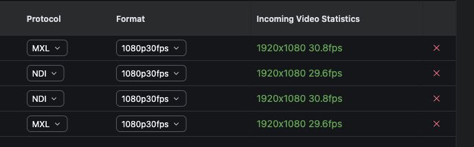
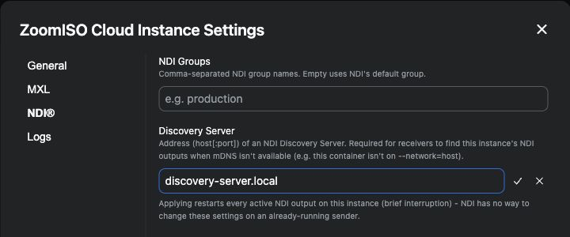

# ZoomISO Cloud MXL versus NDI comparison — 2026-10-13

This checkpoint compares two co-located 1920x1080p30 paths from the same
ZoomISO Cloud participant output on a CPU-only host:

1. ZoomISO publishes v210 video directly into an MXL shared-memory domain.
2. ZoomISO publishes NDI, which is received, decoded, converted to v210, and
   republished into the same MXL domain.

The meeting, participant identity, host addresses, generated flow UUIDs, and
raw operational evidence are intentionally not published.

## Method

All controls used the same active participant, requested format, host, ZoomISO
instance, and observation tooling. Receiver probes measured delivered grain
cadence and drops. A concurrent uniqueness detector measured whether successive
frames contained changing picture content rather than merely arriving at the
advertised cadence.

Three stages were run:

- 10 minutes with one native MXL output and one NDI output active together,
  routed through a two-input MXL Core instance.
- 5 minutes with only the native MXL output active.
- 5 minutes with only the NDI output active, including its required NDI-to-MXL
  receive/decode/convert adapter.

Each stage required all monitored containers to remain running with zero
restarts, receiver drops to remain zero, and content to remain live. The
isolated stages completed with zero monitor errors.

## Isolated-path result

| Path | ZoomISO average CPU | Adapter average CPU | Combined average CPU | Average unique picture rate |
| --- | ---: | ---: | ---: | ---: |
| Native MXL | 165.74% | none | 165.74% | 29.90 fps |
| NDI through MXL adapter | 212.65% | 148.35% | 361.00% | 27.45 fps |

CPU percentages use the container convention where 100% is one logical CPU.
For this workload, the complete NDI path consumed approximately 2.18 times the
average CPU of the native MXL path.

Measured ranges:

| Measurement | Native MXL | NDI path |
| --- | ---: | ---: |
| ZoomISO CPU | 147.07-197.50% | 172.05-235.65% |
| ZoomISO RSS | 1.680-1.687 GiB | 1.763-1.772 GiB |
| Adapter CPU | n/a | 127.35-169.56% |
| Adapter RSS | n/a | 105.20-107.50 MiB |
| Delivered grain cadence | 29.7-30.3 fps | 29.7-30.3 fps |
| Unique picture cadence | 29.0-30.3 fps | 14.7-30.0 fps |
| Receiver drops | 0 | 0 |

The NDI transport continued delivering grains at approximately 30 fps, but
some observation windows contained repeated pictures. The native MXL path
remained in the detector's healthy state for every isolated observation.

## Simultaneous-path result

Both paths negotiated 1920x1080p30 and completed the 10-minute simultaneous
run without probe drops, restarts, timeouts, reader reopenings, selected-input
regressions, no-common-window errors, sustained-unavailable alarms, or monitor
errors. Core remained running throughout.

Resource ranges while both paths and Core were active:

| Service | CPU | RSS |
| --- | ---: | ---: |
| ZoomISO | 288.25-428.75% | 1.691-1.709 GiB |
| NDI receive/decode/convert adapter | 171.85-226.07% | 110.80-127.40 MiB |
| MXL Core | 39.11-60.73% | 76.88-78.14 MiB |

The native path produced 24.3-30.3 unique pictures per second. The NDI-return
path produced 17.3-30.3 unique pictures per second and periodically entered the
detector's degraded state while continuing to deliver approximately 30 grains
per second. Twelve late-read events were observed across both inputs during the
simultaneous run; they did not produce a timeout, active alarm, output stall, or
receiver drop.

## Interpretation

This comparison demonstrates the practical advantage of a codec-free,
shared-memory path on a CPU-constrained production host:

- Native MXL avoids the NDI encode/decode and pixel-conversion work.
- The measured end-to-end MXL path required less than half the average CPU of
  the equivalent NDI-return path.
- MXL preserved a steadier changing-picture cadence even though both transports
  reported nominal 30 fps delivery.
- Core's switching/output work was small relative to the NDI conversion cost.

This result is specific to the tested host, software versions, format, and
co-located topology. It does not claim that NDI is universally unsuitable; it
quantifies the cost of using NDI where a local MXL shared-memory connection is
available.

## Matched two-output scaling control

A follow-up control tested two active outputs per protocol at 1920x1080p30.
Two different participants were used, and the simultaneous stage mapped each
participant once to native MXL and once to NDI. This made the content pairing
identical across protocols while also proving that both paths carried changing
video rather than duplicate frozen frames.

The control comprised:

- 5 minutes with two native MXL outputs;
- 5 minutes with two NDI outputs and two independent NDI-to-MXL adapters; and
- 10 minutes with all two MXL and two NDI paths active together.

All three stages completed with zero monitor errors. Every receiver reported
zero drops, all containers remained running with zero restarts, and no
uniqueness window reported a wedge, silence, or reader error.

**Matched 2x2 test.** Two native MXL and two NDI outputs ran at
1920x1080p30, pairing the same two participants across both protocols. The
public crop omits participant identity while preserving the protocol, format,
and live cadence evidence.

### Isolated two-output resource result

| Path | ZoomISO average CPU | Adapter average CPU | Combined average CPU | Combined average RSS |
| --- | ---: | ---: | ---: | ---: |
| Two native MXL outputs | 294.56% | none | 294.56% | 719.04 MiB |
| Two NDI outputs through two MXL adapters | 455.13% | 360.74% | 815.87% | 866.75 MiB |

The complete two-output NDI path therefore consumed approximately 2.77 times
the average CPU of the matched native MXL path. Its combined average RSS was
approximately 1.21 times the native MXL result.

Measured resource ranges:

| Measurement | Two native MXL outputs | Two NDI outputs |
| --- | ---: | ---: |
| ZoomISO CPU | 263.72-330.30% | 400.28-547.20% |
| ZoomISO RSS | 716.20-722.80 MiB | 632.50-654.50 MiB |
| Adapter 1 CPU / RSS | n/a | 158.59-223.44% / 106.30-114.80 MiB |
| Adapter 2 CPU / RSS | n/a | 166.22-215.66% / 105.40-114.90 MiB |

Both protocols delivered approximately 30 grains per second with zero drops.
The changing-picture detector produced these per-participant results:

| Path | Participant A average / range | Participant B average / range | Degraded windows |
| --- | ---: | ---: | ---: |
| Native MXL | 29.52 / 10.7-30.3 fps | 29.72 / 9.0-30.3 fps | 2/105 and 1/105 |
| NDI return | 26.70 / 15.7-29.7 fps | 29.05 / 21.7-30.7 fps | 2/104 and 1/104 |

The brief degraded windows coincided with source-picture repetition rather
than transport failure: grain cadence remained nominal, drops stayed at zero,
and every flow recovered without intervention.

### Simultaneous 2+2 result

During the 10-minute four-path stage, ZoomISO averaged 579.63% CPU
(487.69-658.88%). The two NDI adapters averaged 195.53% and 197.03%, for a
combined measured average of 972.19% across ZoomISO and the adapters. ZoomISO
RSS stayed between 823.60 and 832.10 MiB; adapter RSS ranges were
106.30-122.30 MiB and 107.50-112.70 MiB.

All four probes averaged approximately 30 fps and reported zero drops. Their
monitor-window rendered-grain deltas were 17,927 and 17,918 for native MXL and
17,922 and 17,924 for the NDI returns. This is consistent with continuous
30-fps delivery throughout the stage.

Paired changing-picture results favored the native path even though transport
cadence was the same:

| Participant | Native MXL average unique rate | NDI-return average unique rate | MXL / NDI degraded windows |
| --- | ---: | ---: | ---: |
| A | 29.23 fps | 26.03 fps | 4/207 / 36/207 |
| B | 28.67 fps | 25.32 fps | 4/207 / 70/207 |

No degraded window became a wedge, silent flow, reader error, restart, or
receiver drop. The difference is picture repetition under load, not loss of
the nominal transport cadence.

## Multi-output NDI operational finding

Direct-address NDI receiver connections were adequate for the single-output
control but proved fragile after receiver disconnects and repeated live
protocol changes. Listener sockets could remain present while no longer
yielding media to a newly attached receiver.

The reliable multi-output configuration used the NDI Discovery Server already
supplied with the installed ZoomISO/NDI package. The server address must be
entered explicitly in ZoomISO's **Settings > NDI Discovery Server** field; it
is not enough to configure discovery only on the receiving adapters. ZoomISO
then registered each named output with that server, and both independent
adapters connected by source name. Those discovery-based connections remained
attached throughout the isolated and simultaneous acceptance windows.
Multi-output deployments should therefore use discovery rather than depending
on manually inferred direct ports.

**Multi-output NDI discovery.** The Discovery Server address belongs in
ZoomISO's NDI settings; configuring discovery only on the receiving adapters
was not sufficient. The hostname in this public screenshot is an illustrative
replacement, not the private test-network address.

## Next control

Extend the matched 2+2 topology to a longer soak, then repeat at four native
MXL plus four matched NDI outputs if host capacity permits. Preserve the same
per-flow cadence, uniqueness, drop, restart, and resource checks, and add the
audio continuity measurements planned for the output architecture.
